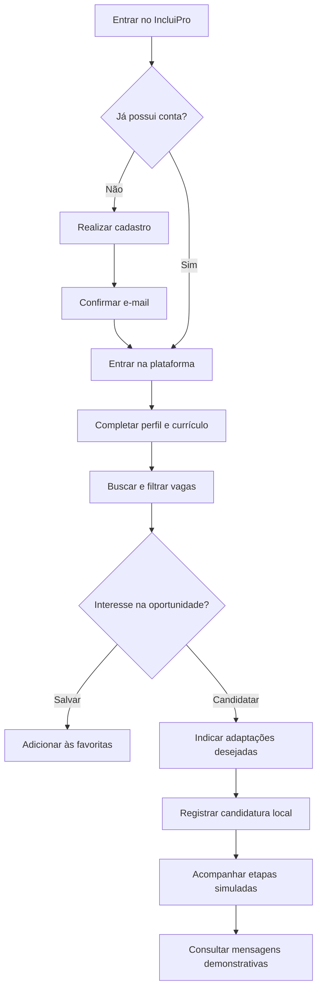

# IncluiPro — Talento sem Barreiras
**Plataforma de empregabilidade para Pessoas com Deficiência (PcD)**
> Desenvolvida pela equipe **Pixel Devs**
## 1. Identificação

| Campo | Informação
|---|---|
| **Nome do site** | IncluiPro|
| **Nome da equipe** | Pixel Devs |
| **Disciplina** | Desenvolvimento front-end para web |
| **Instituição** | Universidade Cidade de São Paulo — UNICID |
| **Professor** | _Paulo Sergio Fratta Junior_ |

### Integrantes

| Nº | Nome | RGM
|---|---|---|
| 1 | _ANA BEATRIZ MENDES GONÇALVES_ | __ |
| 2 | _ARTHUR GABRIEL MARTINS DA COSTA_ | _preencher_ |
| 3 | _FELIPE PEREIRA VESCIA_ | _preencher_ |
| 4 | _LUIZ GUSTAVO SANTOS DE OLIVEIRA_ | _preencher_ |
| 5 | _ROGINER HAIZ DOS SANTOS_ | _preencher_ |
 6 | _SAMANTHA PAULA DOS SANTOS SILVA_ | _preencher_ |
---
## 2. Visão geral

O **IncluiPro** é um projeto de site voltado a aproximar pessoas com deficiência de oportunidades de trabalho, oferecendo informações mais claras sobre as condições de acessibilidade das vagas e recursos que ajudam a pessoa candidata a navegar e participar do processo seletivo.

O projeto reúne páginas institucionais, cadastro de usuário, autenticação demonstrativa, criação de perfil e currículo, catálogo de vagas inclusivas, acompanhamento de candidaturas, mensagens simuladas e informações sobre direitos das pessoas com deficiência.

**Estado do projeto:** protótipo front-end funcional. As vagas, empresas e interações de recrutamento são dados de demonstração; não há integração comprovada com sistemas reais das empresas citadas.

## 3. Problema que o projeto procura resolver

Pessoas com deficiência podem encontrar barreiras na busca por emprego, incluindo descrições de vagas que não informam adaptações disponíveis, dificuldades de navegação, pouca transparência sobre as etapas seletivas e falta de um espaço centralizado para apresentar necessidades de acessibilidade.

O IncluiPro propõe uma experiência que evidencia as condições de acessibilidade da oportunidade, permite registrar adaptações solicitadas na candidatura e oferece recursos de navegação assistiva. O propósito é apoiar uma busca de emprego mais informada e inclusiva.

## 4. Objetivos

### Objetivo geral

Desenvolver uma interface web acessível para facilitar a consulta de vagas inclusivas e a organização de candidaturas de pessoas com deficiência.

### Objetivos específicos

- Apresentar oportunidades com informações sobre modalidade de trabalho, remuneração e acessibilidade.
- Permitir cadastro, verificação demonstrativa de e-mail e entrada na plataforma.
- Oferecer preenchimento de perfil, experiências, formação, habilidades e currículo.
- Possibilitar busca, filtros, ordenação e salvamento de vagas.
- Registrar candidaturas e solicitações de adaptação para o processo seletivo.
- Exibir uma simulação de acompanhamento de etapas e conversas.
- Disponibilizar controles de acessibilidade e informações sobre direitos PcD.
- Organizar a interface para telas de diferentes tamanhos.

## 5. Público-alvo

**Público principal:** pessoas com deficiência que buscam oportunidades de emprego, com ou sem experiência profissional.

Tipos de deficiência considerados na plataforma:

- Deficiência visual
- Deficiência auditiva / surdez
- Deficiência física
- Deficiência intelectual
- Autismo (TEA)
- Deficiência múltipla-


## 6. Tecnologias e arquitetura

| Tecnologia ou serviço | Aplicação no projeto |
| --- | --- |
| HTML5 | Estrutura das páginas, formulários, seções e elementos semânticos. |
| CSS3 | Identidade visual, responsividade, estados visuais e apresentação dos componentes. |
| JavaScript | Navegação, validações, filtros, armazenamento, acessibilidade e lógica das páginas. |
| `localStorage` | Persistência local de contas, sessão, perfil, candidaturas, mensagens e avaliações. |
| EmailJS | Tentativa de envio de códigos de verificação e mensagens de contato, mediante serviço configurado. |
| FormSubmit | Alternativa de envio do formulário de contato, sujeita à ativação/configuração. |
| ViaCEP | Consulta de endereço a partir do CEP informado no perfil. |
| VLibras | Widget externo de tradução de conteúdo para Libras. |
| Web Speech API | Leitura em voz alta por meio dos recursos disponíveis no navegador. |

### 6.1 Páginas do sistema

| Nº | Página | Arquivo | Acesso | Função |
|---|---|---|---|---|
| 1 | Início | `index.html` | Livre | Apresentação, passos, vagas recomendadas, leis e depoimentos |
| 2 | Como funciona | `como-funciona.html` | Livre | Passo a passo, diferenciais, perguntas frequentes, privacidade e termos de uso (resumo) |
| 3 | Sobre nós | `sobre.html` | Livre | Equipe Pixel Devs, sobre o projeto, integrantes e formulário de contato |
| 4 | Cadastro | `cadastro.html` | Livre | Criação de conta |
| 5 | Confirmar e-mail | `verificar.html` | Livre | Digitação do código de 6 dígitos enviado por e-mail |
| 6 | Entrar | `entrar.html` | Livre | Login |
| 7 | Meu painel | `painel.html` | Login | Resumo da conta, vagas recomendadas e progresso do perfil |
| 8 | Meu perfil | `perfil.html` |  Login | Currículo, objetivo profissional, formação, habilidades e perfil de acessibilidade |
| 9 | Vagas | `vagas.html` | Login | Lista, recomendações, busca, filtros e candidatura |
| 10 | Empresas | `empresas.html` | Login | Lista de empresas com busca |
| 11 | Empresa | `empresa.html` | Login | Detalhes, vagas abertas e avaliações da empresa |
| 12 | Minhas vagas | `candidaturas.html` | Login | Vagas salvas, candidaturas, entrevistas e arquivadas |
| 13 | Mensagens | `mensagens.html` | Login | Conversas com as empresas |
| 14 | Leis e direitos PcD | `leis.html` | Login | Direitos, Lei de Cotas, inclusão profissional e fontes oficiais |
```
## 7. Estrutura de arquivos

```text
PROJETO-IncluiPro-v6/
├── index.html                 # Página inicial
├── sobre.html                 # Sobre o projeto e contato
├── como-funciona.html         # Explicação da jornada do usuário
├── cadastro.html              # Cadastro de conta
├── verificar.html             # Confirmação de e-mail
├── entrar.html                # Login
├── painel.html                # Painel pessoal
├── perfil.html                # Perfil e currículo
├── vagas.html                 # Catálogo e filtros de vagas
├── candidaturas.html          # Vagas salvas e processos seletivos
├── mensagens.html             # Conversas demonstrativas
├── empresas.html              # Listagem de empresas
├── empresa.html               # Detalhes e avaliações de empresa
├── leis.html                  # Leis e direitos PcD
├── limpar-dados-teste.html    # Ferramenta de limpeza para desenvolvimento
├── css/
│   └── style.css              # Estilos globais e responsivos
├── js/
│   ├── nav.js                 # Menu, sessão e proteção de páginas
│   ├── auth.js                # Cadastro, login e verificação
│   ├── app.js                 # Vagas, candidaturas e mensagens
│   ├── perfil.js              # Perfil, currículo, CEP e documentos
│   ├── paginas.js             # Empresas, avaliações e contato
│   └── script.js              # Ferramentas de acessibilidade
├── img/
│   └── empresas/
│       └── LEIAME.txt         # Orientações para logos
├── COMO-O-CODIGO-FUNCIONA.md  # Notas técnicas originais
└── LEIAME-EMAIL.md            # Notas de configuração de e-mail
```

## 8. Funcionalidades detalhadas

### 8.1 Página inicial (`index.html`)

É a porta de entrada da plataforma. Apresenta a proposta de inclusão profissional, orienta a navegação para outras áreas e convida visitantes a conhecer a solução ou criar uma conta.

### 8.2 Cadastro e verificação (`cadastro.html`, `verificar.html`, `js/auth.js`)

O formulário coleta dados de criação da conta, valida campos e exige senha com pelo menos oito caracteres. O sistema verifica a confirmação da senha e a existência de conta com o mesmo e-mail **no armazenamento local daquele navegador**.

Após o cadastro, é criado um registro temporário de verificação. O código possui seis dígitos e validade programada de **10 minutos**. O código pode ser enviado por EmailJS quando a configuração e a conexão funcionam; existe também tratamento para modo de demonstração. Após a confirmação, a conta passa a constar na lista local de usuários.

**Limitação de segurança:** o código é validado no JavaScript do navegador. O hash simples de senha presente no projeto não é adequado para proteção de senhas em produção.

### 8.3 Login e controle de acesso (`entrar.html`, `js/nav.js`)

A autenticação compara os dados fornecidos com as contas armazenadas no navegador. A sessão é registrada localmente. Páginas marcadas com `data-protegida` exigem sessão e direcionam visitantes sem login para a página de entrada, preservando o destino de retorno com o parâmetro `next`.

Essa proteção serve para a demonstração da navegação; não substitui autorização no servidor.

### 8.4 Perfil e currículo (`perfil.html`, `js/perfil.js`)

A área de perfil permite registrar informações profissionais e pessoais, incluindo endereço, formação, experiências, habilidades, competências, idiomas e cursos. O preenchimento do CEP pode consultar a API ViaCEP para sugerir dados do endereço, com opção de preenchimento manual.

Há campos para tipo e especificação da deficiência e inclusão de laudo médico em PDF. O código verifica a extensão, o tipo informado e o início do arquivo, além de impor limite de **5 MB**. Dependendo do tamanho e da capacidade do armazenamento local, o conteúdo do documento pode não ficar integralmente preservado, mantendo-se apenas metadados como nome e tamanho.

A área também contém campos opcionais de diversidade, tratados como dados pessoais sensíveis ou potencialmente sensíveis. O projeto deve evitar coletar informações desnecessárias em uma futura versão real.

### 8.5 Catálogo de vagas (`vagas.html`, `js/app.js`)

O catálogo contém **oito vagas pré-definidas de demonstração**, com título, empresa, modalidade de contratação, formato de trabalho, localização, faixa salarial, competências e informações de acessibilidade.

A pessoa pode pesquisar por termos relacionados à vaga, empresa ou competências; filtrar por tipos de deficiência, recursos de acessibilidade e modalidade; e ordenar por compatibilidade, salário ou publicação recente.

A ficha de cada oportunidade descreve recursos como intérprete de Libras, compatibilidade com leitores de tela, acessibilidade física, tecnologia assistiva, flexibilidade de horário, trabalho remoto, ambientes com menor estimulação e legendas, conforme o cadastro demonstrativo da vaga.

**Atenção:** nomes de empresas e salários no código são conteúdo ilustrativo; não devem ser apresentados como anúncios oficiais ou vagas disponíveis em tempo real.

### 8.6 Salvar vagas e candidatar-se

O usuário pode marcar vagas como favoritas. Ao abrir uma vaga, o fluxo de candidatura consulta o perfil e o currículo e permite indicar adaptações desejadas para o processo seletivo, como entrevista em texto, tempo adicional, legendas, materiais acessíveis, pausas e local acessível.

A candidatura é registrada no `localStorage` e pode gerar uma mensagem automática de confirmação. **Não ocorre envio real de currículo ou candidatura para a empresa anunciada.** A mensagem de sucesso representa a conclusão da operação dentro do protótipo.

### 8.7 Acompanhamento de candidaturas (`candidaturas.html`)

A página organiza os registros em quatro abas: **Salvas**, **Candidaturas**, **Entrevistas** e **Arquivadas**. É possível visualizar etapas, acessar a vaga, abrir as mensagens e arquivar ou restaurar candidaturas.

O código inclui progressão automática demonstrativa de etapas baseada no tempo decorrido, com intervalos de aproximadamente dois minutos. Portanto, o status não representa decisões de recrutadores reais.

### 8.8 Mensagens (`mensagens.html`)

O sistema mantém conversas locais vinculadas a oportunidades, incluindo mensagens automáticas de boas-vindas ou confirmação. Permite visualizar e interagir com o histórico de mensagens dentro do próprio navegador.

**Não há chat em tempo real nem integração com contas de recrutadores.** As mensagens fazem parte da simulação da experiência.

### 8.9 Empresas e avaliações (`empresas.html`, `empresa.html`, `js/paginas.js`)

As páginas apresentam empresas associadas às vagas de demonstração, seus detalhes e avaliações. Usuários autenticados podem publicar uma avaliação e excluir a própria avaliação, conforme as regras da interface. As notas e comentários são salvos localmente e não constituem avaliações públicas sincronizadas entre usuários.

A exibição de logos procura inicialmente uma imagem na pasta `img/empresas/`, depois tenta um ícone externo do site e, em último caso, utiliza uma representação com a letra inicial.

### 8.10 Leis e direitos (`leis.html`)

A página apresenta informações sobre inclusão e direitos da pessoa com deficiência, incluindo a **Lei Brasileira de Inclusão (Lei nº 13.146/2015)** e a **Lei de Cotas (art. 93 da Lei nº 8.213/1991)**. É um recurso educativo e não substitui orientação jurídica. As referências devem ser revisadas antes de uma publicação oficial para confirmar sua atualização.

### 8.11 Sobre e contato (`sobre.html`, `js/paginas.js`)

Apresenta o projeto e oferece formulário de contato. O código tenta o envio por EmailJS e pode recorrer ao FormSubmit, se habilitado; quando essas alternativas não funcionam, pode abrir o aplicativo de e-mail do visitante. O envio depende de configuração válida, internet e disponibilidade dos serviços externos.

## 9. Acessibilidade

A acessibilidade é um elemento central da proposta e aparece em diferentes partes da implementação:

- **Ajuste de tamanho do texto:** controles de aumento e redução da fonte.
- **Alto contraste:** opção de alterar a apresentação visual para facilitar a leitura.
- **Redução de movimento:** diminui efeitos de movimento, considerando também preferências do sistema operacional.
- **Leitura em voz alta:** utiliza síntese de fala disponibilizada pelo navegador.
- **VLibras:** incorpora o tradutor virtual externo para Libras, sujeito à conexão com a internet.
- **Navegação por teclado:** inclui tratamento de foco, atalhos e controles como abas navegáveis por setas.
- **Mensagens acessíveis:** utiliza avisos para tecnologias assistivas em diversas interações.
- **Layout responsivo:** adapta grids, espaçamentos e navegação para diferentes larguras de tela.

A existência desses recursos **não comprova conformidade integral com WCAG ou eMAG**. Essa conformidade exige auditoria, testes com leitores de tela, navegação exclusivamente por teclado e avaliação com pessoas usuárias reais.

## 10. Armazenamento dos dados

O projeto utiliza o `localStorage`, recurso do navegador que permite guardar pequenas quantidades de informação entre visitas ao site no mesmo navegador e origem.

| Chave | Finalidade |
| --- | --- |
| `incluipro_users` | Contas cadastradas localmente. |
| `incluipro_session` | Identificação da sessão local. |
| `incluipro_pending_verification` | Cadastro aguardando confirmação. |
| `incluipro_perfil_<email>` | Informações de perfil e currículo. |
| `incluipro_cands_<email>` | Candidaturas registradas. |
| `incluipro_salvas_<email>` | Vagas favoritas. |
| `incluipro_msgs_<email>` | Mensagens da simulação. |
| `incluipro_avaliacoes` | Avaliações locais das empresas. |

**Consequências:** os dados não são compartilhados automaticamente entre dispositivos, não existe backup centralizado, a capacidade de armazenamento é limitada e limpar os dados do site pode eliminar informações. Alterações feitas diretamente no armazenamento ou no código do navegador também podem contornar regras da interface.

## 11. Como executar o projeto

### Requisitos

- Navegador atualizado, como Chrome, Edge ou Firefox.
- Um servidor HTTP local para testes recomendados.
- Internet para funcionalidades dependentes de serviços externos, como EmailJS, ViaCEP e VLibras.

### Passo a passo

1. Extraia o arquivo `PROJETO-IncluiPro-v6.zip` para uma pasta.
2. Abra a pasta no Visual Studio Code, se desejar editar o código.
3. Abra um terminal na raiz do projeto.
4. Com Python instalado, execute:

```bash
python -m http.server 8000
```

5. Acesse no navegador:

```text
http://localhost:8000
```

6. Navegue pela página inicial, crie uma conta de teste, confirme o código conforme o fluxo disponível e explore perfil, vagas e candidaturas.

**Alternativa:** utilizar uma extensão de servidor local, como Live Server, no VS Code. Abrir arquivos diretamente com `file://` pode prejudicar integrações externas e fluxos que dependem da origem do site.

## 12. Roteiro sugerido para testar

| Teste | Resultado esperado |
| --- | --- |
| Abrir a página inicial | Conteúdo institucional e navegação aparecem. |
| Acessar página protegida sem login | Redirecionamento para entrar. |
| Tentar cadastro com senhas diferentes | Exibição de mensagem de validação. |
| Criar uma conta de teste | Início do processo de confirmação por código. |
| Confirmar o código válido | Conta local habilitada para login. |
| Preencher CEP válido | Tentativa de preenchimento via ViaCEP. |
| Aplicar filtros em vagas | Lista atualizada conforme os critérios. |
| Salvar uma vaga | Vaga aparece entre as favoritas. |
| Registrar candidatura de teste | Registro aparece em candidaturas locais. |
| Arquivar candidatura | Item passa para a aba Arquivadas. |
| Ajustar contraste e fonte | Interface reage às configurações. |
| Atualizar a página | Dados locais permanecem, se o navegador permitir. |

Estes são **cenários de teste recomendados**, não um relatório de testes automatizados executados.

## 13. Limitações conhecidas

1. **Sem banco de dados:** armazenamento exclusivamente local e sem sincronização.
2. **Autenticação de demonstração:** senha e sessão controladas no navegador, sem autenticação segura no servidor.
3. **Verificação de e-mail client-side:** mesmo com envio por EmailJS, a validação ocorre no front-end.
4. **Vagas fictícias ou demonstrativas:** não existe atualização automática de vagas reais.
5. **Candidaturas simuladas:** não são transmitidas a recrutadores.
6. **Mensagens simuladas:** não existe comunicação real em tempo real com empresas.
7. **Avaliações locais:** não são compartilhadas entre navegadores.
8. **Arquivos sensíveis:** armazenamento local de laudos e informações pessoais não é solução apropriada para produção.
9. **Serviços externos:** algumas funções dependem de internet e de configuração de terceiros.
10. **Sem evidência de testes automatizados:** o pacote não contém uma suíte de testes nem configuração de integração contínua.

## 14. Privacidade, LGPD e segurança

O perfil pode reunir dados pessoais e dados sensíveis, como informações sobre deficiência, laudos e dados de diversidade. Em um sistema real, a coleta e o tratamento dessas informações exigem base legal adequada, finalidade definida, minimização, transparência, controles de acesso e medidas de segurança proporcionais ao risco, em conformidade com a LGPD (Lei nº 13.709/2018).

**Recomendações prioritárias antes de disponibilizar a plataforma a usuários reais:**

- Implementar autenticação e autorização em backend, com hash de senha robusto, como Argon2id ou bcrypt.
- Validar códigos de e-mail no servidor, com expiração e limite de tentativas.
- Utilizar banco de dados com políticas de acesso, backups e registro de eventos relevantes.
- Armazenar documentos em serviço protegido, com acesso restrito, e não no `localStorage`.
- Definir critérios de necessidade para coleta de laudos e dados de diversidade; evitar exigir laudo sem justificativa adequada.
- Publicar política de privacidade e definir prazos de retenção e exclusão.
- Implementar controles contra abuso, validação no servidor e medidas de segurança de aplicação.
- Revisar a divulgação de nomes, marcas e vagas demonstrativas para evitar confusão com parcerias oficiais.
- Remover `limpar-dados-teste.html` de qualquer implantação pública.

## 15. Melhorias futuras

### Curto prazo

- Revisar e padronizar a documentação.
- Adicionar testes manuais sistemáticos e testes automatizados de interface.
- Verificar contraste, foco, formulários e navegação com tecnologias assistivas.
- Separar claramente os dados demonstrativos dos dados de produção.

### Médio prazo

- Criar backend e banco de dados relacional.
- Implementar autenticação real, recuperação de senha e verificação segura de e-mail.
- Criar cadastro e painel para empresas, com moderação e gestão de vagas.
- Permitir candidatura real, acompanhada de consentimento e políticas de compartilhamento.
- Criar armazenamento seguro de currículos e documentos.

### Longo prazo

- Integrar notificações de candidatura e mensagens reais.
- Desenvolver métricas de acessibilidade e inclusão dos processos seletivos.
- Construir mecanismos transparentes de recomendação de vagas, evitando inferências discriminatórias sobre deficiência.
- Realizar testes de usabilidade com pessoas com diferentes necessidades de acessibilidade.

## 16. Fluxo do usuário

## 17. Diferenciais do projeto

O IncluiPro procura colocar a **acessibilidade no centro da experiência de busca por emprego**, e não apenas como uma informação secundária. Destacam-se a ficha de acessibilidade de cada vaga, os filtros por adaptações disponíveis, a possibilidade de indicar necessidades durante a candidatura, os recursos de leitura e Libras e a apresentação de direitos relacionados à inclusão profissional.

Esses diferenciais são características da proposta e da interface implementada; sua eficácia prática ainda precisa ser validada com usuários reais.

## 18. Conclusão
O IncluiPro demonstra como tecnologias web podem ser organizadas para criar uma experiência de busca por oportunidades profissionais com foco na inclusão de pessoas com deficiência. A versão analisada reúne múltiplos fluxos de navegação e interações em um protótipo front-end que pode apoiar apresentações, estudos e validações iniciais.

Para evoluir de demonstração para serviço real, o principal próximo passo é desenvolver infraestrutura segura de dados e autenticação, seguida de integrações efetivas com empresas e avaliações de acessibilidade com o público-alvo.

---

**Documentação elaborada a partir da análise dos arquivos presentes em `PROJETO-IncluiPro-v6.zip` (versão fornecida em novembro de 2026).**

